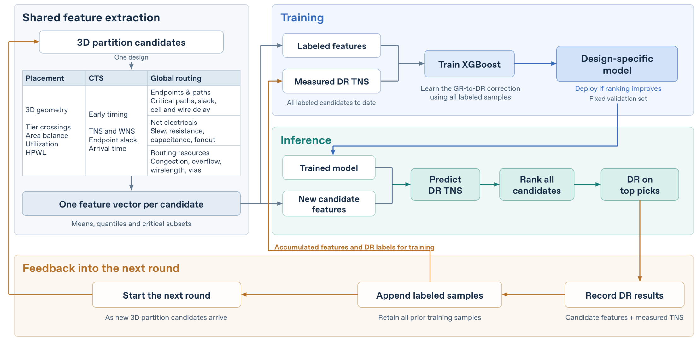
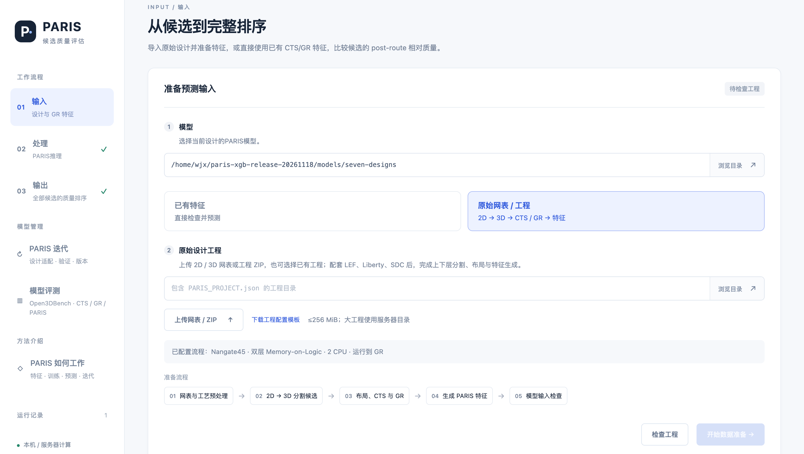
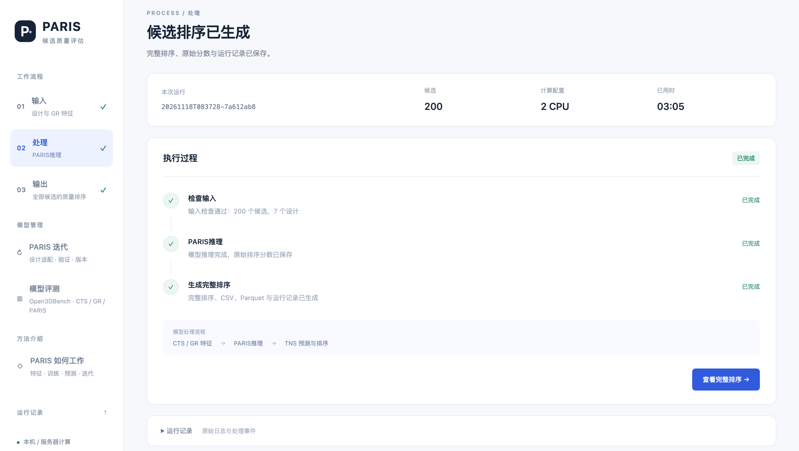
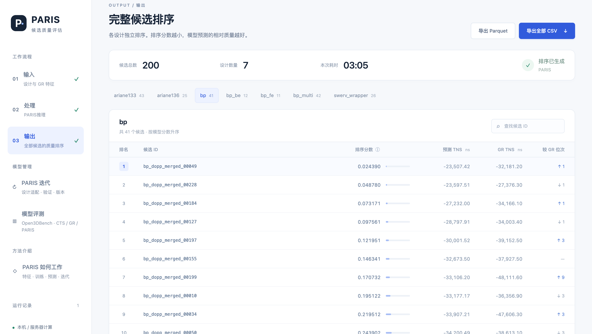
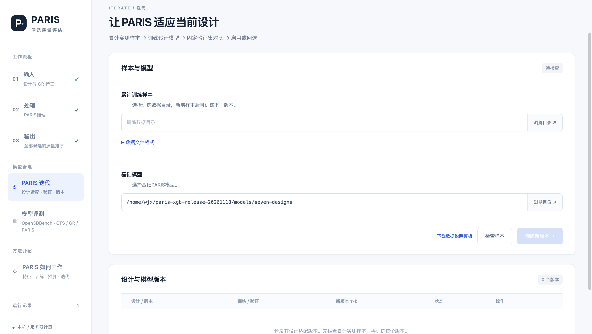
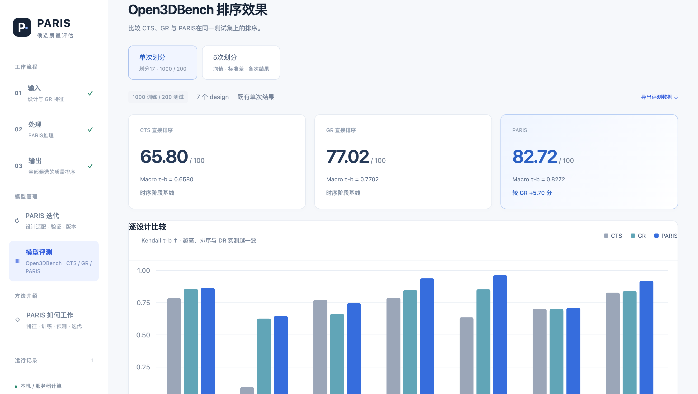

# PARIS

PARIS predicts post-routing total negative slack (TNS) and ranks 3D-IC partition candidates using placement, CTS and global-routing features. It trains one XGBoost model per design and supports model updates as DR labels accumulate.

## Workflow

[](docs/assets/paris-workflow.png)

## Web interface

### 1. Prepare inputs

Import a design project or load existing CTS/GR features.

[](docs/assets/web-input.png)

### 2. Run inference

Check inputs, run PARIS and track processing progress.

[](docs/assets/web-inference.png)

### 3. Rank and export

Compare candidates within each design and export CSV or Parquet results.

[](docs/assets/web-ranking.png)

### 4. Adapt the model

Add labeled samples, train a design-specific model and manage versions.

[](docs/assets/web-iteration.png)

### 5. Compare ranking quality

Compare CTS, GR and PARIS on Open3DBench using Kendall's tau-b.

[](docs/assets/web-evaluation.png)

## Install and launch

Python 3.10–3.12. The physical-design flow requires Linux.

```bash
git clone https://github.com/959AI994/PARIS.git
cd PARIS
python3 -m venv .venv
source .venv/bin/activate
python -m pip install -r requirements.txt -e .
python scripts/start_web.py --open
```

Open `http://127.0.0.1:8765`. The web interface loads the bundled models and candidate example, with pages for prediction, model iteration, evaluation and the method overview.

## CLI prediction and training

```bash
paris predict --model models/seven-designs \
  --dataset examples/gr-candidates --output work/ranking.csv

paris train --dataset my-history --output work/my-model
paris predict --model work/my-model \
  --dataset new-candidates --output work/new-ranking.csv
```

Input: `features.parquet`, `source_sink.parquet`, `net_load.parquet` and `FEATURE_CONTEXT.json`. Training also requires `labels.parquet` and `PARIS_TRAINING.json`. See [input formats](docs/INPUTS.md).

Output: candidate IDs, predicted TNS and ranking. For a new design, train a model on that design's labeled candidates. The web interface supports cumulative training data, fixed validation sets and model version management.

## RTL to candidate predictions

Follow [EDA setup](docs/EDA_SETUP.md) to build Place-MoL and configure OpenROAD and Yosys.

```bash
python scripts/configure.py --openroad /opt/OpenROAD/build/bin/openroad \
  --yosys /opt/yosys/yosys

# Predict new candidates with an existing design model
paris design --project examples/or1200-source --settings native.json \
  --model models/or1200 --candidates 2 --seed 73 --output work/or1200-run

# New design: use 24 of 36 candidates for DR calibration
paris design --project my-source --settings native.json \
  --candidates 36 --label-budget 24 --output work/my-design
```

The bundled flow targets Nangate45 two-tier Memory-on-Logic designs. Other technologies require matching flow and library configurations. After configuration, the web interface also supports project-based data preparation.

## Reproduce the five evaluation splits

```bash
python evaluation/five-splits/reproduce.py --output work/evaluation
# Retrain from the saved splits and verify predictions
python evaluation/five-splits/reproduce.py --refit --output work/refit
```

Each split contains 1,000 training and 200 test candidates. The approximately 21 MB archive includes split IDs, features, labels, 35 models and expected results.

## Repository layout

```text
src/paris_tool/    CLI, web interface, models and data pipelines
models/           Trained model bundles
examples/         Candidate features and source project
configs/          Tool configuration templates
scripts/          Build, configuration and launch utilities
vendor/           Open3DBench components, Place-MoL and OpenROAD-3D
evaluation/       Five evaluation splits and reproduction scripts
docs/             Setup, input formats, method and validation
```

Third-party sources and licenses: [vendor/SOURCES.json](vendor/SOURCES.json), [NOTICE](NOTICE).
